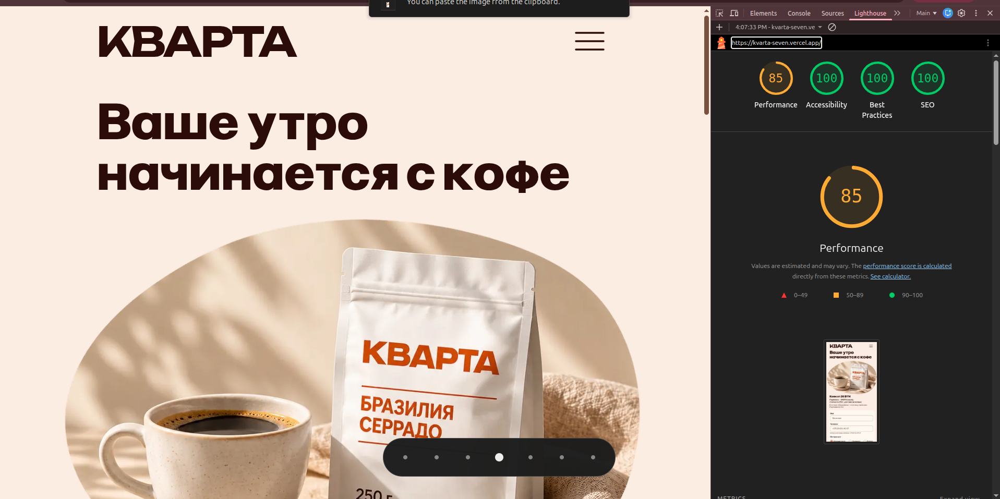

# Кварта — development with AI

Кварта is a landing page for a fictional Minsk coffee roastery. I used Codex
throughout development, from understanding the brief to preparing deployment.
I made the product decisions, checked the results and approved the changes.

[Website](https://kvarta-seven.vercel.app/) ·
[Project guide and local setup](docs/project-guide.md) ·
[Documentation](docs/README.md)

## How I used AI

1. **Requirements and planning.** I asked Codex to analyze the brief, identify
   open questions and help resolve them. We recorded decisions in
   [PRODUCT.md](docs/PRODUCT.md) and organized the work into a
   [roadmap](docs/roadmap.md).
2. **Architecture.** We discussed the stack, storage, local development and
   hosting. I selected Vercel + Neon, PostgreSQL in Docker for offline
   development, and required Telegram notifications.
3. **Design exploration.** I used the local Impeccable skill and AI image
   generation to explore visual options. I selected `cosy-pack.png`, then
   refined the fonts, colors, coffee cards and decorative linework through
   feedback and visual comparisons. The current design uses a white canvas
   with warm surfaces and orange accents.
4. **Feature development.** We followed
   `task → data-modeler → builder → test → review`. Codex used separate agent
   sessions for data contracts, testing and review. Tasks and handoffs stayed
   in the conversation; durable decisions and progress stayed in the docs.
5. **Iteration from my feedback.** I tested the interface and requested visible
   selection feedback, pack quantities and the ability to choose several coffee
   varieties together. Codex implemented these changes in the shared order and
   callback flow.
6. **Verification and debugging.** Codex ran lint, TypeScript, database, browser
   and accessibility checks. Automated testing also found concrete defects, such
   as phone-mask editing deleting an adjacent digit and a decorative line sitting
   too close to the price on a narrow screen. These were corrected and checked
   again. Recorded commands and results are in the conversation and
   [development guide](docs/development.md).
7. **Deployment preparation.** Codex helped with migrations, the PostgreSQL
   version upgrade, environment configuration and step-by-step Neon/Vercel
   setup. We kept incremental Git commits and recorded what had actually been
   verified.

## My review and manual testing

I checked every step AI performed and tested the application manually as well.
My reviews and hands-on testing helped me identify AI mistakes, missing behavior
and the changes I wanted. I checked the interface, tried the controls and
reported problems before accepting the results.

For example, I noticed that clicking «Выбрать» did not clearly show what I had
chosen. I requested visible selection, quantities such as two 250 g packs, and
then selection of several coffee types at once. I also reviewed design variants,
font readability, spacing, phone-number formatting and background colors.
Automated checks and independent AI reviews supplemented my manual testing.

## Lighthouse evidence

I supplied this Lighthouse screenshot from
[the public Vercel URL](https://kvarta-seven.vercel.app/): **85 performance,
100 accessibility, 100 best practices and 100 SEO**.

The screenshot shows the earlier peach design, before the white-canvas and
linework update. It does not record the complete device and throttling settings.
Earlier local lab measurements are documented separately in the
[development guide](docs/development.md#visual-and-performance-evidence);
they are not the deployed score shown here.

## Assumptions and remaining verification

The business is fictional and its facts come from the supplied brief. Orders
are finalized by a manager after a callback; online payment is outside scope.
Delivery below 50 BYN and the subscription composition are confirmed by the
manager.

The public-page screenshot is evidence of that captured deployment. Full
production persistence, preview isolation, real Telegram delivery and scheduled
recovery still need recorded end-to-end release verification. The
[release checklist](docs/release.md) tracks those checks; local tests use a
simulated Telegram transport.

## What was implemented

- A responsive Russian-language landing page with the roastery story, coffee
  offers, subscription, delivery and pickup information.
- The selected cosy composition, local fonts and coffee imagery, a white canvas,
  warm product cards and decorative orange linework throughout the page.
- Multi-coffee selection, individual pack quantities, subtotals, combined totals
  and delivery information shared between cards and the callback form.
- A callback form with formatted Belarusian phone input, server validation and
  pending, saved, duplicate and recoverable-error states.
- PostgreSQL lead storage, ten-minute phone-based duplicate protection,
  advertising attribution and price snapshots for selected items.
- A transactional notification outbox, Telegram transport, local simulator,
  retries, lease recovery and authenticated notification-management endpoints.
- Docker PostgreSQL 18 for local development, versioned SQL migrations, isolated
  tests, Neon connection/migration preparation and Vercel configuration.
- Social preview metadata, browser and accessibility checks, and maintained
  product, architecture, development, design and release documentation.
