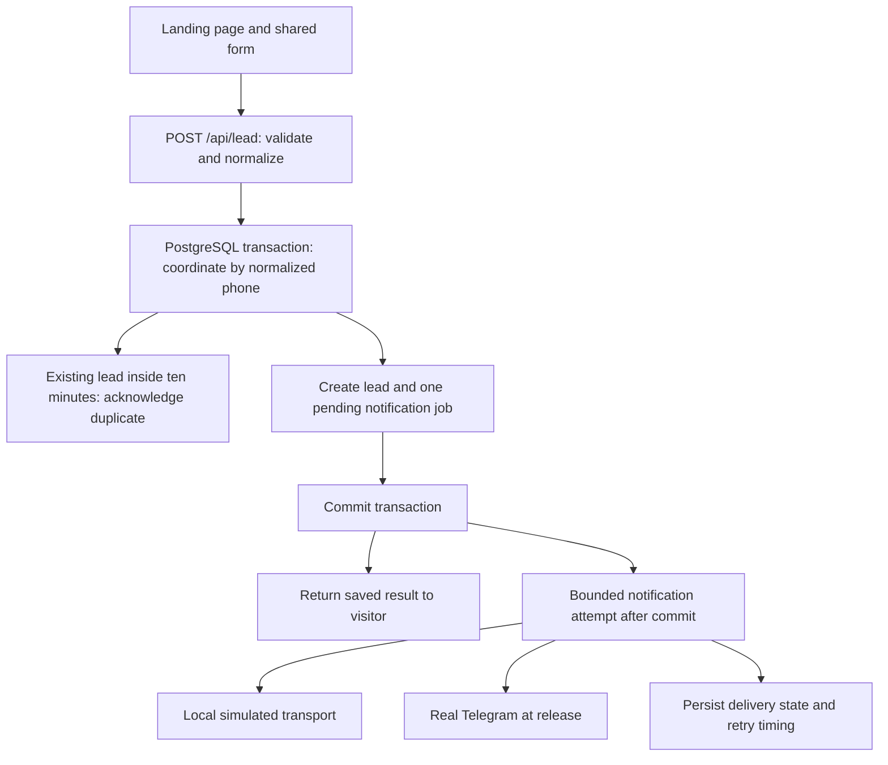

# Architecture

Status as of 2026-10-18: the local foundation, lead intake, and durable notification
worker are implemented. Real Telegram verification and the full landing page
remain planned. Use the [roadmap](roadmap.md) for verified progress and the
[product document](PRODUCT.md) for requirements.

## Stack and boundaries

| Area | Selected approach | Current state |
| --- | --- | --- |
| Application | Next.js App Router, TypeScript, Node.js 24, npm | Implemented; placeholder page only. |
| UI | CSS Modules, CSS custom properties, local Cyrillic fonts and imagery | Planned against the approved original `cosy-pack.png`. |
| Lead endpoint | `POST /api/lead`, Node.js runtime, Zod, `libphonenumber-js/max` | Implemented; see the [API contract](api.md). |
| Database | PostgreSQL 17; `pg` with parameterized SQL | Docker and lazy server-only pool implemented. |
| Migrations | Timestamped SQL through stable `node-pg-migrate` | Implemented; `app.leads` and `app.notification_outbox` persist accepted requests/jobs. |
| Catalog | Typed source content and local assets | Planned; no catalog database or CMS needed. |
| Notifications | PostgreSQL outbox and bounded Telegram delivery worker | Local simulator, transport adapter, leases, retries, and authenticated recovery implemented; real service verification belongs to release. |
| Verification | Node.js test runner, disposable real PostgreSQL, isolated Next.js HTTP server | Migration, validation, concurrency, boundary, and rollback checks implemented; browser form coverage planned. |
| Hosting | Vercel application + Neon PostgreSQL | Selected; provision only in the final release feature. |

One application serves the page and API. Server components can render the static
content; client code handles the form and necessary interactions. Database code
and credentials stay server-only. Leads are stored in PostgreSQL so deployments
and process restarts do not erase them. A filesystem file or function memory is
not the lead store. No ORM, separate backend, authentication system, admin app,
cart, or payment service is required for the agreed scope.

The current pool is initialized on first database use and reused during local
hot reload. It is capped at five connections. Builds of the current static page
do not require a database. Reassess connection limits and the Vercel pool lifecycle
at release; do not initialize migrations during a request or application build.

## Lead flow

Validation, duplicate coordination, and atomic lead/job persistence are
implemented, including delivery attempts after commit. The visitor form belongs to F4.

Validation failures never create a lead or notification job. Normalize valid
Belarusian phone numbers to one canonical representation before duplicate checks.
Validate interest against the product's three supported choices. Bound accepted
field sizes and product context; enforce validation on the server even when the
browser also checks input. The [API contract](api.md) records exact field limits,
response shapes, and HTTP statuses.

Coordinate same-phone writes in the database, including simultaneous requests
across application instances. A transaction performs the duplicate decision and
creates the lead plus its outbox job atomically. An application-only lookup
followed by an uncoordinated insert is insufficient. Use database time for the
decision. A READ COMMITTED transaction acquires a transaction-scoped advisory
lock on `hashtextextended('kvarta:lead:' || normalized_phone, 0)`, then reads
`clock_timestamp()::text` in a separate statement after the lock. The atomic
lead/outbox SQL uses this full-precision timestamp for the comparison and inserts.
A hash collision only serializes unrelated phones. Lock waits are limited to
three seconds and statements to five seconds; failures roll back and return 503.
Accept a new lead when the previous accepted lead is at least ten
minutes old; rejected duplicates do not extend the window. Recheck this boundary
under concurrent requests and with differently formatted versions of one number.

A committed lead is success even when Telegram is unavailable. A database error
before commit is a recoverable submission failure. Duplicate responses should
acknowledge the earlier request without exposing another lead's private fields.
The browser preserves entered values on recoverable errors.

## Data ownership

The second SQL migration defines the lead and outbox tables. `accepted_at` and
the outbox timestamps use PostgreSQL `timestamptz`; IDs are UUIDs. The lead lookup
is indexed on `(phone, accepted_at DESC)`. The outbox has a unique `lead_id` foreign
key and constraints for allowed status, lease, and sent-time combinations. Pending
and processing indexes support delivery. The lead transaction creates pending
jobs with zero attempts; the worker owns subsequent delivery-state transitions.

| Data | Owner and lifecycle |
| --- | --- |
| Lead | PostgreSQL: stable ID, accepted timestamp, name, normalized phone, interest, optional comment, product context, and attribution. Persists independently of app deployments. |
| Duplicate coordination | Database transaction/constraint or lock strategy keyed by normalized phone; no process-local cache as the authority. |
| Notification outbox | PostgreSQL: one pending job per accepted lead, delivery state, attempt count, next eligible time, claim/lease information, and safe failure details. Created with the lead. |
| Attribution | Capture UTM parameters, applicable advertising click IDs, landing URL, and available referrer; bound and validate these as untrusted input. Preserve them through form retries. |
| Catalog and business copy | Versioned application source, grounded in the supplied brief; changes require a code change and deployment. |
| Images and fonts | Local application assets with source/license or generation provenance. Mockups remain design references. |
| Secrets | Ignored local environment files and deployment environment configuration; never catalog content, browser bundles, logs, or committed docs. |

There is no customer account or manager UI in the initial scope. Authorized
operators can inspect leads and notification state through database access and
the protected retry mechanism. Decide an appropriate retention and
deletion practice before collecting real contacts; do not add unrelated tracking
or log submitted phone numbers/comments for debugging.

## Telegram reliability

The existing outbox schema supports delivery without an additional migration.

- Use a simulated transport locally and in automated tests. It supports
  success, transient failure, throttling, terminal failure, and timeout scenarios.
- Attempt delivery after commit using Next.js `after()`, prioritizing the new
  lead internally. Saved/duplicate responses remain unchanged even if scheduling
  fails. A drain claims at most three jobs sequentially, starts no new job after
  a 20-second budget, and bounds each send at three seconds. Routes advertise a
  60-second platform limit; deployment interruption still requires recovery.
- Claim due jobs atomically, prevent ordinary simultaneous sends of one job,
  and recover abandoned claims using a 30-second database-time lease. A short
  transaction uses `FOR UPDATE SKIP LOCKED` to claim one job just before sending,
  increments its lifetime attempts, and installs a fresh UUID token. No database
  connection is held during network work. Result writes require the same token,
  processing state, and an unexpired lease. Stale workers cannot overwrite recovery.
  Database statements have two-second timeouts and one-second lock limits.
- Persist attempt results, retry transient failures with backoff, and honor
  Telegram's `retry_after`. Retain terminal failures for correction and manual
  retry; do not silently delete them. Transients retry indefinitely at 30 seconds
  times two to the power of attempts minus one, capped at one hour. A valid
  provider delay is a lower bound and may exceed that cap. Throttling stops the
  current batch; timing is persisted per job, not a global bot rate limiter.
- Send a bounded plain-text or correctly escaped message containing the stable
  lead ID, contact, interest, context, comment, and useful attribution.
  The adapter sends plain text without markup parsing and disables link previews.
  Messages fit within 3,900 UTF-16 units; long comments/attribution are explicitly
  shortened while complete values remain in PostgreSQL. No payload is logged.
- Drain due jobs on subsequent lead requests, provide an authenticated manual
  retry path, and add a daily recovery cron during release. A public lead request
  must not act as an unrestricted job-management endpoint.

Delivery is at least once: an ambiguous network timeout can repeat a Telegram
message. A lease cannot provide exactly-once delivery across PostgreSQL and
Telegram. The saved lead ID helps the manager recognize repeats.

The recorded Vercel Hobby cron constraint was once per day with imprecise timing
when checked on 2026-10-18. It must be rechecked at release. Under this design,
normal delivery is prompt, but outage recovery has no rapid-delivery guarantee.
If a stricter recovery target becomes necessary, revisit scheduling and cost.
Reference APIs: [Telegram sendMessage](https://core.telegram.org/bots/api#sendmessage),
[Next.js after](https://nextjs.org/docs/app/api-reference/functions/after), and
[Vercel cron limits](https://vercel.com/docs/cron-jobs/usage-and-pricing).
Read the installed Next.js documentation before implementing version-sensitive
APIs; these links are references, not evidence of a deployed integration.

## Environments

| Environment | Database | Telegram | Provisioning |
| --- | --- | --- | --- |
| Local development | Docker PostgreSQL 17, named volume | Simulated transport | Available now. |
| Automated database tests | Separate generated Compose project, random loopback port, temporary storage | Forced simulated transport; real adapter uses stubbed fetch | Current harness creates and removes its own resources. |
| Preview | Separate Neon development/preview branch; never production data | Mock or separate test target | Final release feature. |
| Production | Neon PostgreSQL 17, persistent lead/outbox tables | Real configured bot/chat | Final release feature. |

Runtime uses `DATABASE_URL`; migrations prefer `DATABASE_URL_DIRECT` and fall
back to the runtime URL locally. At release, use Neon's pooled URL for runtime
and direct URL for migration advisory locking. Require the provider's supported
TLS settings and scope environment values separately for preview and production.
`.env.example` includes database, transport, simulator, bot/chat placeholders,
and `CRON_SECRET` for recovery authentication. The [development guide](development.md)
documents exact settings and operating procedures. No real credentials are required locally.

The [release checklist](release.md) covers migrations, environment separation,
actual external-service verification, and operating/recovery instructions.
